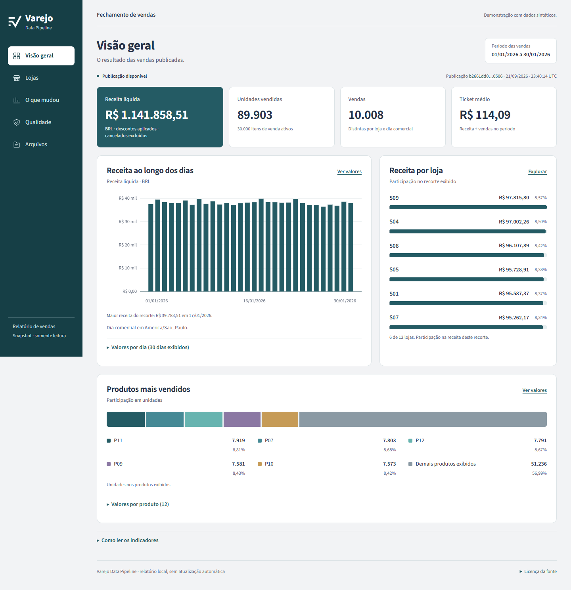
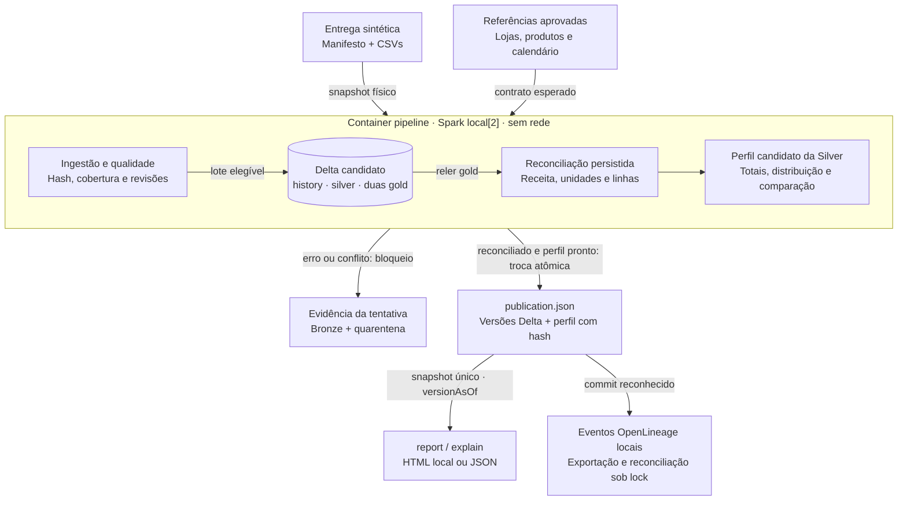
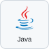
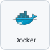

# Varejo Data Pipeline

Conferência de entregas e revisões de vendas antes de publicar um fechamento.

<!-- Navegação do README -->
<p>
  <a href="#demonstração"></a>
  <a href="#arquitetura"></a>
  <a href="#executar-localmente"></a>
  <a href="#verificação-e-evidências"></a>
  <a href="https://www.linkedin.com/in/arthur-joanes-6a2967373/"></a>
</p>

## Visão geral

O projeto responde a três perguntas: o total está completo, quais revisões foram aceitas e a qual publicação cada indicador pertence? Desenvolvi a ingestão, as regras de revisão, a [publicação por manifesto](src/retail_pipeline/publication.py) e o relatório para uma rede fictícia. Os dados são sintéticos; não há adoção comercial nem ganho financeiro medido.

O fechamento também conserva um perfil da Silver ativa. A comparação identifica a publicação anterior e recalcula datas e lojas em comum antes de avaliar variações. Eventos OpenLineage ficam no disco e podem ser reexportados após uma falha. [Contratos e roteiros de evolução](docs/evolution.md).

<a id="na-prática"></a>
<a id="como-uma-falha-aparece-para-quem-consulta"></a>

## Demonstração



_Dados sintéticos de 30 mil linhas de vendas entre 01 e 30/01/2026, publicados em 21/09/2026. A imagem mostra o painel atual sobre essa publicação histórica; sua geração não executou novos lotes Spark._

[Ver no celular](docs/readme/dashboard-mobile.png) · [Guia do relatório](docs/interface.md)

| Área | O que consultar |
| --- | --- |
| Visão geral | Receita, vendas, unidades, ticket médio e evolução diária |
| Lojas | Receita por loja e dia, com zero distinto de ausência |
| O que mudou | Comparação de métricas nas mesmas datas e lojas |
| Qualidade | Pendências, bloqueios e resultado da última tentativa |
| Arquivos | Origem, versões e identificadores da publicação |

O ranking destaca até seis lojas; a participação considera todas as lojas com receita conhecida no recorte. O mix mostra os cinco produtos com mais unidades e agrupa os demais. Gráficos têm valores e tabelas para consulta. O HTML funciona offline e permite leitura sem JavaScript.

A [prova de negócio](docs/evidence/editorial-20260922/business-thesis.json) exercita uma sequência menor, separada do painel acima:

| Caso | Resultado observado |
| --- | --- |
| Entrega de S02 ausente | Bloqueio; R$ 64,00 anteriores permanecem publicados |
| Apenas um item de A1 muda de dia | `SALE_DATE_CONFLICT`; receita sozinha não aprova a revisão |
| Processo falha entre as duas tabelas finais | Leitores oficiais continuam em R$ 64,00/R$ 64,00 |
| Retomada e repetição | R$ 74,00; repetição `NO_CHANGE`, mesma publicação |

[Comandos e resultados da execução de 22/09/2026](docs/evidence/editorial-20260922/execution.json) · [Demonstrações disponíveis](docs/demo.md)

<a id="implementação"></a>
<a id="como-protejo-a-publicação"></a>

### Paleta da marca


| Cor | Código | Uso |
| --- | --- | --- |
| Azul petróleo | `#245B64` | Marca, links, ações e gráficos |
| Petróleo escuro | `#163F46` | Navegação lateral |
| Azul escuro | `#263248` | Texto e valores |
| Branco | `#FFFFFF` | Papel e foco sobre fundo escuro |
| Cinza claro | `#F2F3F5` | Fundo da página |
| Verde | `#226348` | Entrega confirmada e sucesso |
| Ocre | `#76550E` | Aviso para conferência |
| Vermelho | `#923B35` | Pendência e bloqueio |

Os estados combinam cor e texto. A matriz mantém zero, ausência e valores negativos distintos. [Convenções da interface](docs/interface.md).

## Arquitetura

O fechamento passa pela entrega recebida, pelo cálculo do candidato e pela publicação autorizada para leitura. O batch é um processo Spark local; as tabelas Delta compartilham o volume de estado, mas cada uma tem sua própria versão. Por isso, o ponto de publicação é um manifesto que fixa o conjunto de versões.



| Responsabilidade | Implementação e contrato |
| ---------------- | ------------------------ |
| Fixar o que se espera das lojas | [`references.py`](src/retail_pipeline/references.py) grava `operator-references.json`; o calendário enviado na entrega não redefine a cobertura aprovada. |
| Preservar e validar a entrada | [`ingestion.py`](src/retail_pipeline/ingestion.py) copia bytes antes do parsing; [`batch_contracts.py`](src/retail_pipeline/batch_contracts.py) e [`contracts.py`](src/retail_pipeline/contracts.py) conferem documentos e linhas. Um erro bloqueia o lote inteiro. |
| Resolver revisões e calcular indicadores | [`pipeline.py`](src/retail_pipeline/pipeline.py) coordena as etapas; [`transformations.py`](src/retail_pipeline/transformations.py) deduplica histórico, escolhe a maior revisão e agrega apenas `UPSERT` nas duas gold. |
| Tornar várias tabelas visíveis juntas | [`publication.py`](src/retail_pipeline/publication.py) mantém `flock` de escritor único e substitui o ponteiro JSON com `fsync` + `os.replace`; leitores usam os caminhos e versões registrados. |
| Consultar e apresentar o fechamento | [`reporting.py`](src/retail_pipeline/reporting.py) lê um snapshot; [`report_model.py`](src/retail_pipeline/report_model.py) define o payload e [`report_view.py`](src/retail_pipeline/report_view.py) renderiza o HTML com gráficos de [`report_charts.py`](src/retail_pipeline/report_charts.py). |
| Comparar a composição e exportar proveniência | [`profiling.py`](src/retail_pipeline/profiling.py) conserva o perfil no snapshot e recalcula o recorte equivalente; [`lineage.py`](src/retail_pipeline/lineage.py) exporta estados duráveis em OpenLineage. |

No caminho principal, `run` adquire o lock, copia a entrega e compara suas revisões com o **histórico da publicação anterior**. Sem conflitos, grava candidatos, relê e reconcilia as duas gold, então troca `publication.json`. Se houver falha entre gravações, o ponteiro anterior continua válido; a retomada recompõe o candidato a partir dele. Repetir um lote já publicado retorna `NO_CHANGE` após as validações. [Fluxo e falhas exercitados](tests/integration/test_pipeline.py).

O [Compose](compose.yaml) monta o estado em `/data`, o código somente para leitura em `/app` e as exportações em `artifacts/`. O servidor opcional entrega relatórios HTML diretamente nessa pasta, recusa links simbólicos e deixa os JSONs para consulta local no disco. Abrir o relatório não executa Spark nem atualiza os dados. Veja os [grãos das tabelas, a sequência de publicação e os limites de recuperação](docs/architecture.md).

<a id="o-que-eu-implementei"></a>
<a id="stack"></a>

## Stack e decisões

<p>
  
  
  
  
</p>

| Componente                    | Papel e escolha verificável                                                 |
| ----------------------------- | --------------------------------------------------------------------------- |
| Python/PySpark                | Validação de entrada e transformações em lote                               |
| Delta Lake                    | Histórico e versões por tabela; o manifesto da aplicação reúne a publicação |
| Java                          | Runtime do Spark dentro da imagem                                           |
| Docker Compose                | Estado local isolado e servidor opcional do relatório                       |
| HTML, CSS e JavaScript locais | Relatório portátil com leitura básica sem JavaScript                        |

O projeto fixa **Spark 4.2.0 e Delta 4.4.0** nas [dependências Python](pyproject.toml), combinação prevista nas [notas oficiais Delta](https://github.com/delta-io/delta/releases/tag/v4.4.0). O [Dockerfile](Dockerfile) define o runtime; os artefatos JVM reconstruídos localmente não são apresentados como releases oficiais.

Recalcular o histórico simplifica revisões e retomadas, mas exige processamento e armazenamento adicionais. Não houve comparação que prove vantagem sobre uma solução menor. [Código da projeção](src/retail_pipeline/transformations.py); [alternativas e compromissos](docs/decisoes-tecnicas.md).

<a id="executar-e-verificar"></a>
<a id="executar-no-windows"></a>

## Executar localmente

Use Docker Desktop com containers Linux, Compose e PowerShell no Windows. Python e Java do batch são instalados pela imagem. O primeiro build precisa de rede; o batch configurado executa sem rede. O [wrapper](scripts/pipeline.ps1) reúne os comandos abaixo.

```powershell
.\scripts\pipeline.ps1 setup
.\scripts\pipeline.ps1 demo
.\scripts\pipeline.ps1 serve
```

`profile` lê o perfil e sua comparação em JSON; `lineage` reconcilia os eventos locais sob o lock do escritor. Ambos dispensam a inicialização do Spark. Os limiares de perfil são parâmetros demonstrativos de `run`; avisos não impedem uma correção válida. [Exportação OpenLineage](docs/openlineage.md).

Abra [localhost:3103/report.html](http://localhost:3103/report.html). No Linux, use `sh scripts/pipeline.sh` com os mesmos comandos. `demo` cria estado com UUID; as exportações em `artifacts/` representam a execução mais recente do comando. [Wrapper Linux](scripts/pipeline.sh) e [demo](src/retail_pipeline/demo.py). [Roteiro completo e limpeza](docs/demo.md).

<a id="ler-e-verificar-o-fechamento"></a>

## Verificação e evidências

Para executar a prova de negócio em estado temporário:

```powershell
docker compose run --rm --entrypoint python pipeline scripts/verify_problem.py --thesis-only --output /app/artifacts/thesis
```

O [runner](scripts/verify_problem.py) chama o [teste de negócio](tests/integration/test_business_thesis.py), que confere resultados com Spark/Delta.

| Evidência                                                                   | Data e alcance                                                                 |
| --------------------------------------------------------------------------- | ------------------------------------------------------------------------------ |
| [Caso de negócio](docs/evidence/editorial-20260922/business-thesis.json)    | 22/09/2026; cobertura, revisão integral e falha entre tabelas                  |
| [Identidade da execução](docs/evidence/editorial-20260922/execution.json)   | 22/09/2026; imagem, comandos e preparação; build com cache                     |
| [Recuperação](docs/evidence/state-proof/restore.json)                       | Execução histórica identificada no registro; restauração em destino local novo |
| [Scan da imagem da demonstração](docs/evidence/editorial-20260922/security.json) | 22/09/2026; resultado vinculado à imagem examinada                             |

Resultados antigos não certificam commits posteriores. [Inventário das verificações](docs/verification.md) · [fontes e afirmações](docs/fontes-e-afirmacoes.md).

Perfis e OpenLineage têm [registros próprios](docs/evidence/evolucao-20261012-a12e4a/): 369 testes na suíte completa identificada, integrações dirigidas, comparação e reexportação reais e restauração com perfis. O [scan da imagem de entrega](docs/evidence/evolucao-20261012-a12e4a/security-delivery-summary.json) passou com zero HIGH/CRITICAL; dois MEDIUM permanecem registrados. [Roteiros e limites](docs/evolution.md).

Na fonte `a5b2a3b`, passaram **402 testes unitários**, Ruff, formato, mypy e build do wheel. O relatório foi verificado em Edge e Firefox, com navegação por teclado, leitura sem JavaScript e larguras de 320 a 1440 px. Axe não encontrou violações automáticas na amostra, mas teve resultados inconclusivos. Zoom nativo e leitor de tela não foram verificados. [Procedimento e alcance](docs/frontend-quality.md).

<a id="limites-e-manutenção"></a>
<a id="limites-que-mantive-explícitos"></a>

## Limites e segurança

O escopo é local: sem autenticação multiusuário, streaming ou implantação Fabric executada. A [publicação](src/retail_pipeline/publication.py) depende do filesystem Linux e de um único escritor. Não há limpeza automática de versões Delta nem prova de recuperação fora do computador; o [ensaio de restauração](docs/evidence/state-proof/restore.json) usa um novo destino local.

Os limites de entrada são configuráveis: por padrão, 1 MiB por JSON, 64 MiB por arquivo, 256 MiB por entrega e 1.000 arquivos. Esses valores definem o orçamento de entrada; a capacidade de processamento exige medição. [Implementação dos limites](src/retail_pipeline/input_limits.py) e [configuração](compose.yaml). O [scan de 22/09/2026](docs/evidence/editorial-20260922/security.json) mantém os achados da imagem examinada, mesmo quando nenhum atinge HIGH/CRITICAL. A [revisão dos 18 pontos de segurança](docs/SECURITY-REVIEW-2026-10-03.md) corrigiu a exposição de arquivos pelo servidor e quatro HIGH no Jackson sombreado do Parquet. O scan de 03/10 mantém somente o MEDIUM documentado de Commons Lang; a revisão registra os testes e seus limites.

## Documentação

[Convenções da documentação](docs/padrao-documentacao.md) · [Fontes e afirmações](docs/fontes-e-afirmacoes.md).

| Para consultar                 | Documento                                                                                                           |
| ------------------------------ | ------------------------------------------------------------------------------------------------------------------- |
| Fluxo, cenários e demonstração | [Demo](docs/demo.md) · [problema e solução](docs/problem-solution.md)                                               |
| Contratos e implementação      | [Arquitetura](docs/architecture.md) · [dados](docs/data-contract.md) · [decisões](docs/decisoes-tecnicas.md)        |
| Operação e riscos              | [Recuperação](docs/state-recovery.md) · [runtime](docs/runtime-upgrade.md) · [segurança](docs/security.md)          |
| Relatório e gráficos | [Interface](docs/interface.md) · [qualidade e testes](docs/frontend-quality.md) |
| Rastrear afirmações            | [Fontes, datas e limites](docs/fontes-e-afirmacoes.md)                                                              |
| Evolução proposta              | [Adaptação Fabric, não executada](docs/fabric-mapping.md)                                                           |

## Autor e licença

<p><a href="https://www.linkedin.com/in/arthur-joanes-6a2967373/"> <strong>Arthur Joanes no LinkedIn</strong></a></p>

[Licença MIT](LICENSE). Ícones da stack e LinkedIn: [Devicon, licença MIT](docs/stack/LICENSE.devicon).

Schemas OpenLineage: [Apache-2.0 e atribuição upstream](src/retail_pipeline/schemas/README.md).

Source Sans 3: [SIL Open Font License](src/retail_pipeline/assets/source-sans-LICENSE.md).
